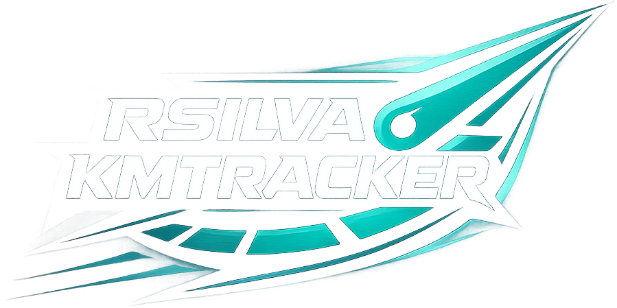
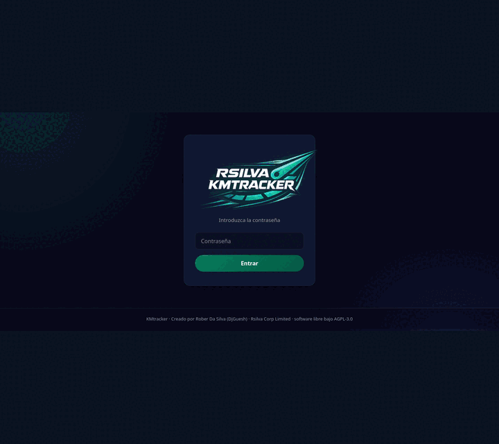
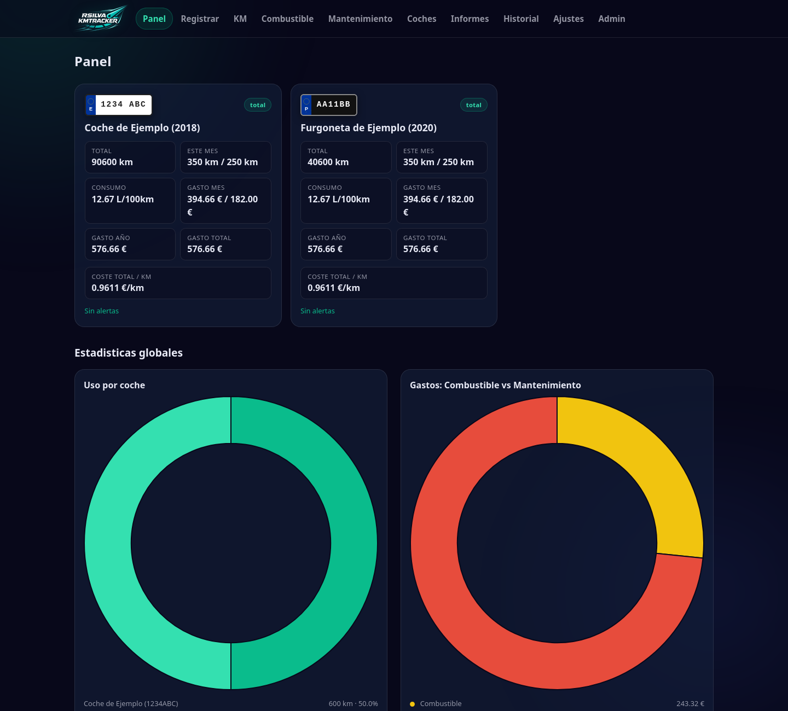
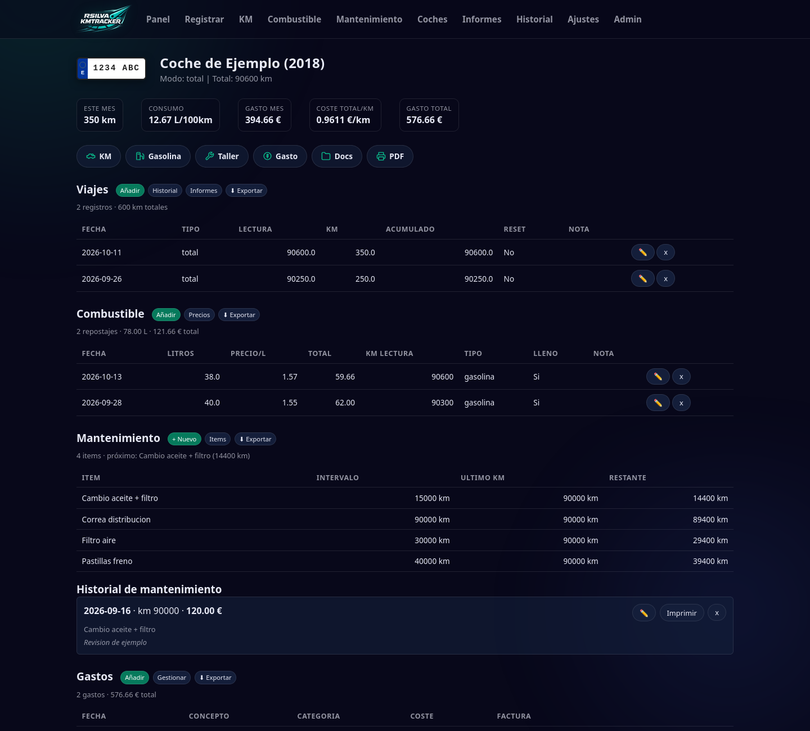
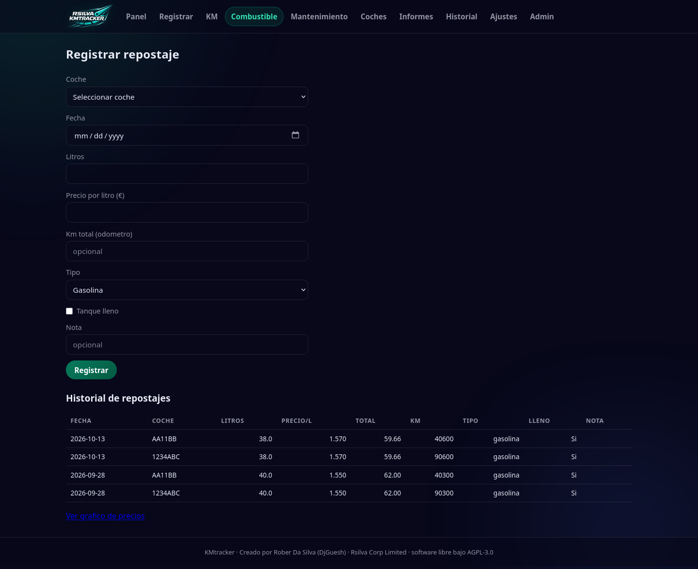
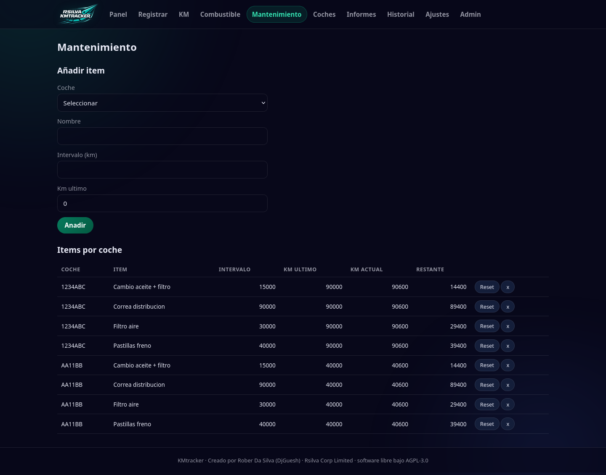
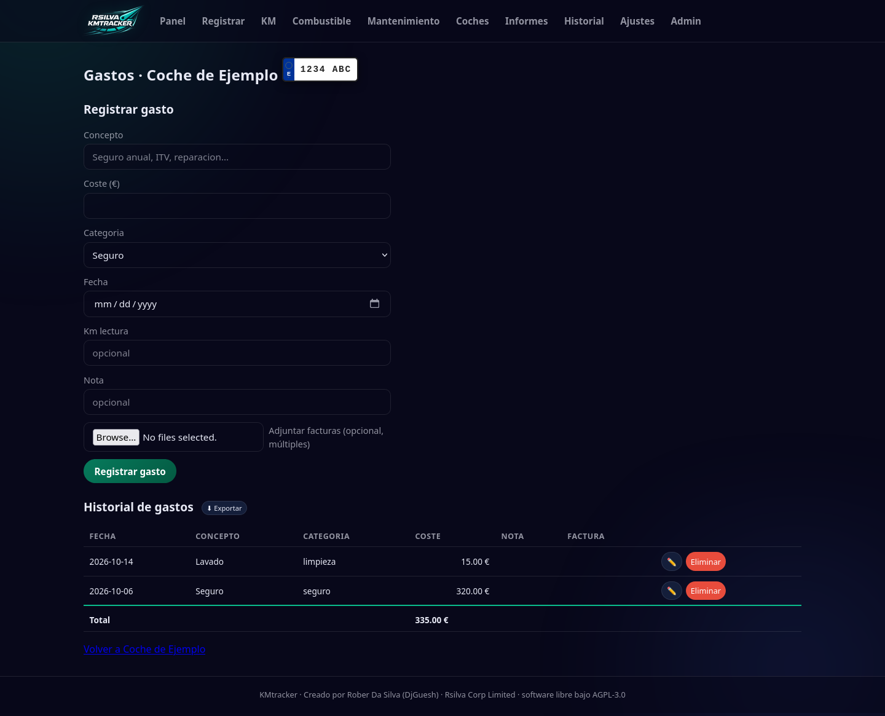
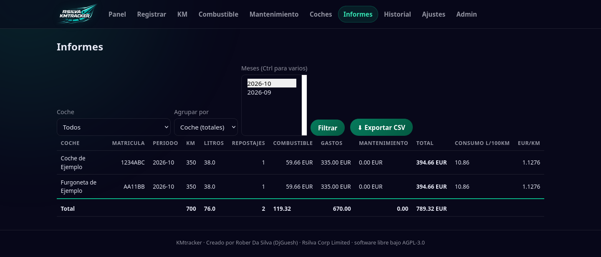
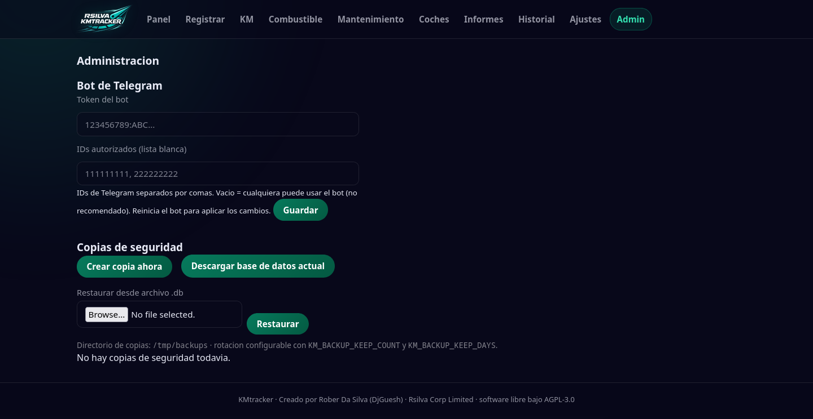
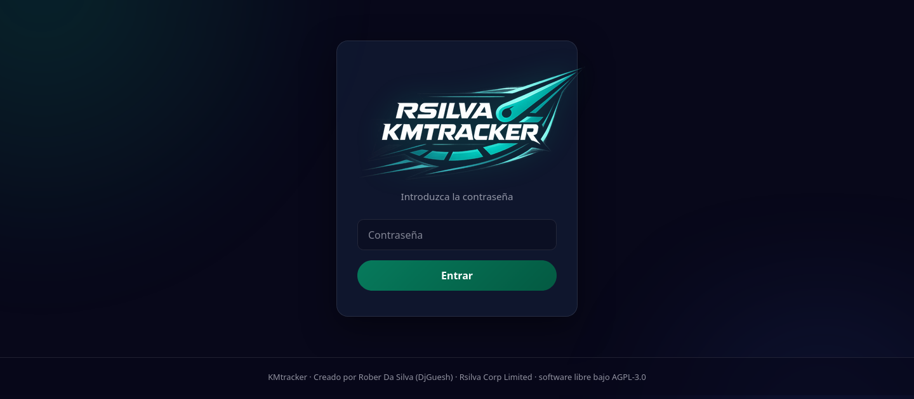

<p align="center">
  
</p>

<h1 align="center">KMtracker</h1>

<p align="center">
  <b>Your own vehicle garage, at home.</b><br>
  Mileage, fuel, expenses and maintenance for all your cars and motorbikes,
  in one place and under your control.
</p>

<p align="center">
  <a href="README.es.md">Leer en español 🇪🇸</a>
</p>

<p align="center">
  <b>Windows user?</b> <a href="#windows-1011-docker-desktop">Install with Docker Desktop</a>
</p>

<p align="center">
  📖 <b><a href="docs/manual/manual-en.md">User manual</a></b> ·
  <a href="docs/manual/manual-en.pdf">PDF version</a> ·
  <a href="docs/manual/manual-es.md">Manual en español</a>
</p>

---

## Contents

- [User manual](docs/manual/manual-en.md)
- [Screenshots](#screenshots)
- [What is KMtracker?](#what-is-kmtracker)
- [Who is it for?](#who-is-it-for)
- [Everything you can do](#everything-you-can-do)
- [Everyday use](#everyday-use)
- [Install with Docker (5 minutes)](#install-with-docker-5-minutes)
- [Windows installation](#windows-1011-docker-desktop)
- [Configuration](#configuration)
- [Telegram bot (optional)](#telegram-bot-optional)
- [Backups](#backups)
- [FAQ](#faq)
- [For developers](#for-developers)
- [Tech stack](#tech-stack)
- [Contact](#contact)
- [License and author](#license-and-author)

---

## Screenshots

<p align="center">
  
</p>

<table>
  <tr>
    <td align="center" width="50%"><b>Dashboard</b><br><a href="docs/capturas/panel.png"></a></td>
    <td align="center" width="50%"><b>Vehicle profile</b><br><a href="docs/capturas/coche.png"></a></td>
  </tr>
  <tr>
    <td align="center" width="50%"><b>Fuel</b><br><a href="docs/capturas/combustible.png"></a></td>
    <td align="center" width="50%"><b>Maintenance</b><br><a href="docs/capturas/mantenimiento.png"></a></td>
  </tr>
  <tr>
    <td align="center" width="50%"><b>Expenses</b><br><a href="docs/capturas/gastos.png"></a></td>
    <td align="center" width="50%"><b>Reports</b><br><a href="docs/capturas/informes.png"></a></td>
  </tr>
  <tr>
    <td align="center" width="50%"><b>Administration</b><br><a href="docs/capturas/admin.png"></a></td>
    <td align="center" width="50%"><b>Login</b><br><a href="docs/capturas/login.png"></a></td>
  </tr>
</table>

---

## What is KMtracker?

KMtracker is a **web application** you install on your own computer, mini-PC,
Raspberry Pi or NAS. It keeps track of your cars and motorbikes: the kilometres
you drive and what you spend on fuel, repairs and maintenance.

Three simple ideas:

- **Your data is yours.** It lives on your machine, in a single file. Nothing is
  sent to any external service.
- **You use it from a browser** on your phone, tablet or computer. It is a normal
  website; there is nothing to install on your devices.
- **Optionally**, you can log entries from your phone with a **Telegram bot**.

Everything fits in **a single Docker image**: the web app, the database and, if
you want it, the bot.

---

## Who is it for?

- For anyone with **one or more vehicles** who wants to know what they really
  cost.
- For anyone tired of spreadsheets and losing fuel receipts.
- For anyone who wants **maintenance reminders** (oil changes, roadworthiness
  test, insurance, taxes) without a paid cloud app.
- For anyone who values **privacy**: no accounts, no cloud, no ads here.

---

## Everything you can do

### 🚗 Vehicles (cars and motorbikes)

- Add **as many vehicles as you like**, cars and motorbikes.
- **Spanish and Portuguese** plates (with validation).
- A profile per vehicle with model, year, engine, chassis and a **photo**.
- Mark vehicles as **test** or **sold/retired** (archived without losing their
  history).
- Choose how you measure distance:
  - **Total odometer** (the counter that never resets).
  - **Partial odometer** (a trip meter you reset to zero).

### 🛣️ Mileage

- Log **trips** (partial readings) or **odometer readings** (totals).
- The distance driven is calculated for you.
- Typo? You can **correct** any reading and everything is recalculated in a
  chain.
- Full history of every kilometre per vehicle.

### ⛽ Fuel

- Record **fill-ups**: litres, price per litre, amount, kilometres and type
  (petrol/diesel).
- Mark whether you filled the **whole tank** so the calculation is exact.
- Computes the **real fuel consumption in L/100 km** for each vehicle.
- Keeps a **price history** for fuel.
- Correct a fill-up's odometer if needed.

### 💸 Expenses

- Log any expense with its **category**:
  **insurance · roadworthiness test · tax · repair · cleaning · maintenance ·
  upgrades · other**.
- Attach **photos of invoices** so everything is documented.
- Free-text notes per expense.
- Totalled per vehicle and per period.

### 🛠️ Maintenance

- Create **km-based maintenance tasks** (e.g. "oil every 10,000 km").
- The app warns you when a task is **due soon** or **overdue**.
- Log each **service performed** with its cost, kilometres and photos.
- Generate **printable thermal receipts (58 mm)** for a receipt printer.
- Generate a **PDF** summary of maintenance per vehicle.

### 📄 Documents

- Store each vehicle's **paperwork** (registration, technical sheet, insurance,
  contracts, etc.) right inside the database.
- Download it whenever you need it.

### 📊 Dashboard and reports

- **Home dashboard** with cards per vehicle: monthly km, consumption, monthly
  cost, yearly cost, total cost and €/km.
- **Choose which widgets** appear on the dashboard (you decide the cards).
- **Charts** of monthly spending with [Chart.js](https://www.chartjs.org/).
- **Reports** by month range and vehicle, exportable to **CSV** (opens straight
  in Excel).
- **Daily report** of activity.
- **Printable report receipt**.

### 🔔 Automatic alerts

- **Maintenance alerts** based on kilometres.
- **Renewal alerts**: insurance, roadworthiness test and road tax, with the lead
  time you configure.

### 🤖 Telegram bot (optional)

Log entries from your phone without opening the browser. See
[Telegram bot](#telegram-bot-optional).

### 🔐 Access and security

- **Single-password login** (you choose it at install time).
- **CSRF** protection on every form.
- **Login rate limiting** to stop brute-force attacks.
- Security headers (no-sniff, no-frame).

### 💾 Backups

- **Local rotating backups** (created and pruned by age automatically), with no
  external service involved.
- Create, list, **download, restore and delete** backups from the admin panel.
- Download or upload the whole `.db` database file.

---

## Everyday use

1. **Add your vehicle.** Menu **Cars → Add**. Enter plate, model, year and pick
   total or partial odometer mode.
2. **Log your fill-ups.** Menu **Fuel**. With a full tank, the app computes real
   consumption for you.
3. **Record your expenses** (insurance, roadworthiness test, garage...) with
   their category and, if you like, a photo of the receipt.
4. **Create your maintenance tasks** with their km interval. The app keeps
   warning you.
5. **Check the dashboard** each month to see what you spent and consumed.
6. **Export a report** as CSV or PDF whenever you need it (e.g. for your taxes or
   to sell the car with its full history).

---

## Install with Docker (5 minutes)

Requirements: **Docker** and **Docker Compose** installed.

```bash
git clone https://github.com/Robertomola18/kmtracker.git
cd kmtracker
cp .env.example .env          # edit .env and set KMTRACKER_PASSWORD
docker compose up -d --build
```

Open in your browser:

```
http://localhost:5050
```

And log in with the password you set in `KMTRACKER_PASSWORD`.

Data is stored in the `kmtracker_data` volume (`/data` inside the container), so
it **survives upgrades**.

Want to try it with **demo data** (fake cars, fill-ups and expenses)?

```bash
docker compose exec kmtracker python3 /app/seed.py
```

> **Security tip:** put KMtracker behind a reverse proxy with HTTPS (Caddy,
> nginx, Traefik) or a VPN such as Tailscale/WireGuard, and expose port 5050
> **on your LAN only**. Do not publish it directly to the Internet.

### Windows 10/11 (Docker Desktop)

KMtracker can also run on Windows 10/11 through **Docker Desktop with WSL2 and
Linux containers**. You do not need to install Python, Pango or WeasyPrint on
Windows: everything runs inside the application image.

Requirements: Windows 10/11 64-bit, hardware virtualization enabled, and Docker
Desktop with the WSL2 backend using Linux containers.

1. Install Docker Desktop and make sure it is using **Linux containers**.
2. Clone the repository and enter the folder:

   ```powershell
   git clone https://github.com/Robertomola18/kmtracker.git
   cd kmtracker
   ```

3. Create `.env`, set a strong password and save the file as UTF-8 without BOM:

   ```powershell
   Copy-Item .env.example .env
   notepad .env
   ```

4. Start the application:

   ```powershell
   docker compose up -d --build
   ```

5. Open <http://localhost:5050> and log in with the password you configured.

To stop: `docker compose stop`. To update: `git pull --ff-only` and
`docker compose up -d --build`. Data in the named volumes is preserved.

> **Windows:** the port is published on all interfaces by default. If you only
> use it on this PC, see how to restrict it to `127.0.0.1` in the guide.

Full guide (Docker Desktop, WSL2, mobile access, bot, backups, updates and
troubleshooting): [windows/README.md](windows/README.md).

---

## Configuration

Everything is configured with environment variables in the `.env` file:

| Variable | Default | What it does |
|---|---|---|
| `KMTRACKER_PASSWORD` | — | Web login password. **Required** on first run. |
| `KMTRACKER_DB_PATH` | `/data/kmtracker.db` | Path of the SQLite database file. |
| `KMTRACKER_SECRET_KEY` | generated in `/data/.secret_key` | Flask session key. |
| `TZ` | `Europe/Madrid` | Time zone. |
| `KM_BACKUP_DIR` | DB folder + `/backups` | Folder where backups are stored. |
| `KM_BACKUP_KEEP_COUNT` | `10` | Number of backups always kept. |
| `KM_BACKUP_KEEP_DAYS` | `30` | Backups older than this are pruned. |
| `TELEGRAM_TOKEN` | — | Telegram bot token (also set in `/admin`). |
| `TELEGRAM_ALLOWED_USER_IDS` | — | Comma-separated allowed Telegram IDs (recommended). |

From the web, under **Settings** you can configure the dashboard widgets and the
alert thresholds (km for warnings and days of lead time for renewals). Under
**/admin** you can configure the bot and manage backups.

---

## Telegram bot (optional)

With the bot you can log kilometres, fill-ups, expenses and maintenance from your
phone, and ask for a vehicle summary.

**Setup:**

1. Talk to [@BotFather](https://t.me/BotFather) on Telegram, create a bot and copy
   the **token**.
2. Find your numeric **Telegram ID** (e.g. with [@userinfobot](https://t.me/userinfobot)).
3. Put them in your `.env`:

   ```env
   TELEGRAM_TOKEN=123456:ABC-DEF...
   TELEGRAM_ALLOWED_USER_IDS=111111111
   ```

4. Start the bot as well:

   ```bash
   docker compose --profile bot up -d
   ```

You can also configure the token and the allowlist from the web, at `/admin`
(they are stored in the database).

**Available commands:**

| Command | What it does |
|---|---|
| `/start` | Welcome and command list. |
| `/menu` | Button menu. |
| `/km` | Log a trip. |
| `/repostar` | Log a fill-up. |
| `/gasto` | Log an expense. |
| `/mantenimiento` | Manage maintenance tasks. |
| `/check` | Vehicle summary. |
| `/alertas` | Alerts for all vehicles. |
| `/cancel` | Cancel the current operation. |

> **Very important:** always set the **allowlist**
> (`TELEGRAM_ALLOWED_USER_IDS`). Without it, anyone who finds your bot can read
> and modify your data.

---

## Backups

Under **/admin** you can **create, list, download, restore and delete** local
backups. Each backup is a `kmtracker_<timestamp>.tar.gz` file containing the
database. You can also download or upload the raw `.db` file directly.

Tip: point `KM_BACKUP_DIR` at a folder on a **mounted NAS** or a **cloud-synced
folder**, and you get off-site copies for free.

Example of an automatic daily backup at 05:00 with cron:

```
0 5 * * * docker compose -f /path/kmtracker/docker-compose.yml exec -T kmtracker \
  python3 -c "import backup,os;backup.create_backup(os.environ['KMTRACKER_DB_PATH'])"
```

---

## FAQ

**Do I need Internet to use it?**
No. You only need it for the Telegram bot (optional). Everything else works on
your LAN.

**Where is my data stored?**
In a single SQLite file inside the `kmtracker_data` volume. You can copy it and
take it with you whenever you like.

**Can several people use it?**
Access is via one shared password. It is meant for personal or family use, not
multi-user accounts.

**What if I enter the wrong kilometres?**
You can edit any reading. The app automatically recalculates the affected
distances and consumption.

**Does it run on a Raspberry Pi?**
Yes. It is built for modest hardware: Flask + SQLite use very little.

**How do I update it?**
```bash
git pull
docker compose up -d --build
```
Your data is preserved in the volume.

---

## For developers

```bash
python3 -m venv venv && . venv/bin/activate
pip install -r requirements.txt -r requirements-dev.txt
KMTRACKER_DB_PATH=/tmp/km.db KMTRACKER_PASSWORD=dev pytest -q
```

Basic project layout:

- `app.py` — Flask web application (routes and views).
- `models.py` — SQLite database and all data logic.
- `bot.py` — Telegram bot (optional).
- `backup.py` — backup creation and rotation.
- `templates/` and `static/` — views and assets.
- `tests/` — automated tests.

---

## Tech stack

Flask · SQLite (WAL mode) · Jinja2 · Chart.js · WeasyPrint (PDF) ·
python-telegram-bot · gunicorn · Docker.

---

## Contact

- **Questions and suggestions:** start a thread in
  [Discussions](https://github.com/Robertomola18/kmtracker/discussions).
- **Bugs and feature requests:** open an
  [issue](https://github.com/Robertomola18/kmtracker/issues).
- **Security issues:** report them **privately** through a
  [Security Advisory](https://github.com/Robertomola18/kmtracker/security/advisories/new)
  instead of a public issue. See [SECURITY.md](SECURITY.md).

---

## License and author

This project is distributed under the **GNU AGPL-3.0** license. See the
[LICENSE](LICENSE) file.

In short: you may use, study and modify KMtracker freely, but if you distribute
it or offer it as a service, you **must also publish the source code** of your
changes. That is how it stays free for everyone.

<p align="center">
  <br>
  Created by <b>Rober Da Silva (DjGuesh)</b> · Rsilva Corp Limited
</p>

<h2 align="center">
  &nbsp;&nbsp;
  100% Spanish product&nbsp;&nbsp;
  
</h2>
