<p align="center">
  
</p>

# KMtracker User Manual

**Mileage, fuel, expenses and maintenance for all your vehicles, in your own home.**

This guide walks you through KMtracker, screen by screen. You don't need any
technical knowledge: if you can use a website, you can use KMtracker. To install
it, see the installation section of the [README](../../README.md) or the
[Installation and configuration](#16-installation-and-configuration) chapter of
this manual.

> **Language:** this manual is also available in Spanish
> ([`manual-es.md`](manual-es.md)).

---

## Table of contents

1. [What is KMtracker](#1-what-is-kmtracker)
2. [Getting started](#2-getting-started)
3. [The dashboard](#3-the-dashboard)
4. [Vehicles](#4-vehicles)
5. [Mileage](#5-mileage)
6. [Fuel](#6-fuel)
7. [Expenses](#7-expenses)
8. [Maintenance](#8-maintenance)
9. [Documents](#9-documents)
10. [Reports](#10-reports)
11. [History](#11-history)
12. [Settings](#12-settings)
13. [Administration](#13-administration)
14. [The Telegram bot](#14-the-telegram-bot)
15. [Backups](#15-backups)
16. [Installation and configuration](#16-installation-and-configuration)
17. [FAQ and troubleshooting](#17-faq-and-troubleshooting)

---

## 1. What is KMtracker

KMtracker is a **web application** that runs on your own machine (a computer, a
mini-PC, a Raspberry Pi or a NAS). It helps you keep track of your cars and
motorcycles: the kilometres you drive and what you spend on fuel, repairs and
maintenance.

Three simple ideas:

- **Your data is yours.** It is stored on your machine, in a single file. Nothing
  is sent to external services.
- **You use it from your browser** on a phone, tablet or computer. There is
  nothing to install on your devices.
- **Optionally**, you can log entries from your phone with a **Telegram bot**.

Every menu of the application is always in the top bar:

**Panel · Registrar · KM · Combustible · Mantenimiento · Coches · Informes ·
Historial · Ajustes · Admin**

> The user interface is in Spanish. This manual lists each screen by its English
> name and, where useful, its Spanish menu label in brackets.

---

## 2. Getting started

### Signing in

Open your KMtracker address in the browser (for example
`http://localhost:5050`) and enter the password defined during installation.

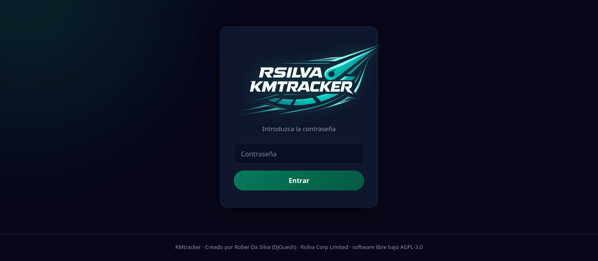

- There is a **single** password for the whole installation (no users or
  accounts). It is designed for personal or family use.
- After several failed attempts, the application temporarily blocks new attempts
  to prevent brute-force attacks.
- To sign out, use the **logout** link in the top-right corner.

### The "Registrar" menu

The **Registrar** (Log) button is a shortcut that gathers the four most common
day-to-day actions:

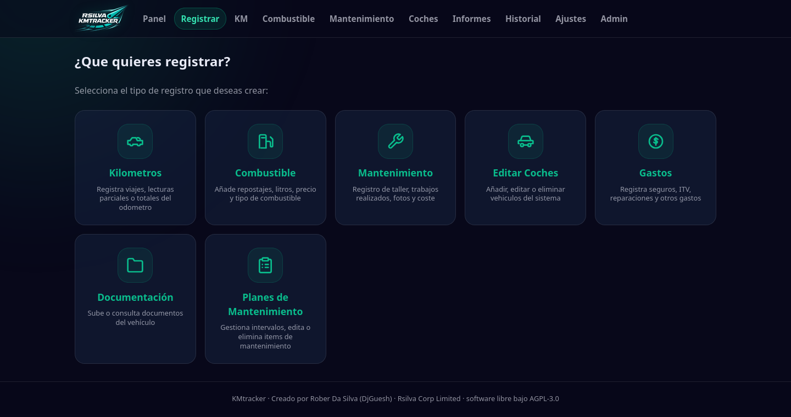

- **Kilómetros** (Mileage) — add a trip or an odometer reading.
- **Combustible** (Fuel) — add a refuelling.
- **Gastos** (Expenses) — add an expense.
- **Documentos** (Documents) — add a document.

Each of these is also available from its own menu in the top bar.

---

## 3. The dashboard

The **Panel** (Dashboard) is the main screen and the summary of your whole fleet.
It opens automatically when you sign in.

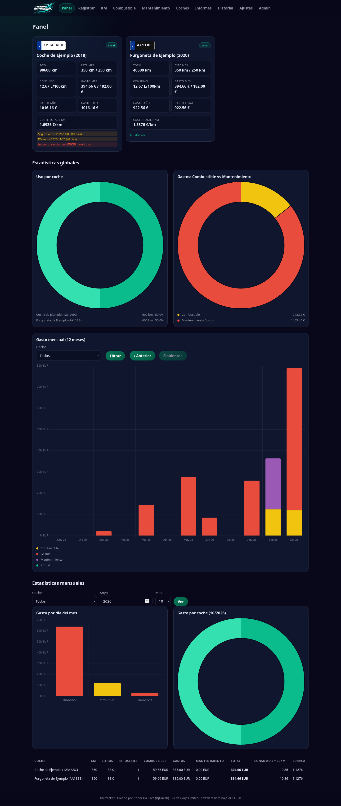

### Per-vehicle cards

Each car or motorcycle appears in a card with its current figures:

- **Total** — accumulated kilometres of the vehicle.
- **Este mes** (This month) — kilometres driven this month, compared with the
  previous month.
- **Consumo** — real consumption in **L/100 km**.
- **Gasto mes** — this month's spending, with the previous month as reference.
- **Gasto año** — spending so far this year.
- **Gasto total** — everything spent since you added the vehicle.
- **Coste total / km** — the real cost per kilometre.

If a vehicle has active warnings (upcoming maintenance, insurance, roadworthiness
test or road tax), they are highlighted at the bottom of its card.

### Global statistics

Below the cards, the dashboard shows charts for the whole fleet:

- **Uso por coche** (Usage per car) — the split of kilometres between vehicles.
- **Gastos: combustible vs mantenimiento** — where the money goes.

### Monthly spending (12 months)

A bar chart of the last twelve months' spending, split by fuel, expenses and
maintenance. You can filter by vehicle and move back and forward in time with the
**Filtrar**, **← Anterior** and **Siguiente →** buttons.

### Monthly statistics

The lower block lets you pick a **car**, a **year** and a **month** and see:

- the **daily spending** for that month,
- the **spending per car** for that month.

> Which cards and blocks appear on the dashboard is chosen in
> [Settings](#12-settings).

---

## 4. Vehicles

### Adding a vehicle

Open **Coches** (Cars), where you'll find the list of vehicles and the form to add
a new one.

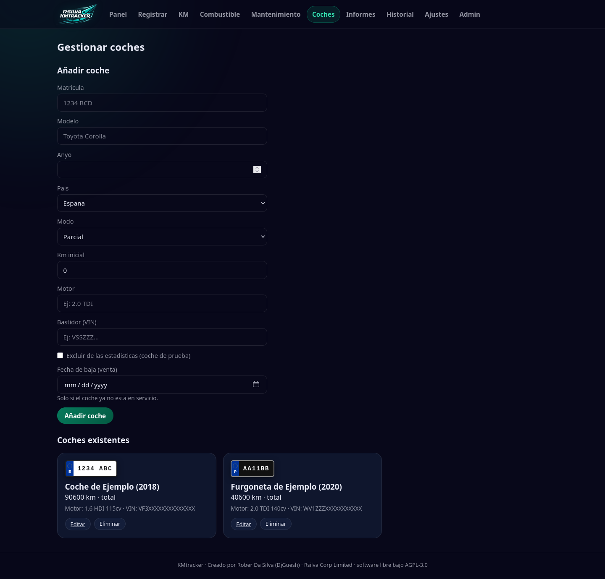

When adding a vehicle, you are asked for:

- **Matrícula** (Plate) — validated for **Spanish and Portuguese** plates.
- **Modelo** — for example, "Seat Leon".
- **Año** (Year) — registration year.
- **Mileage mode** — how you measure kilometres:
  - **Total**: you use the odometer that never resets.
  - **Parcial**: you use the trip meter that is reset to zero.
- **Initial kilometres** — the reading you start tracking from.
- **Photo** (optional) — a picture of the vehicle.

### The vehicle detail page

Click a vehicle to open its **detail page**, the control centre for that specific
car.

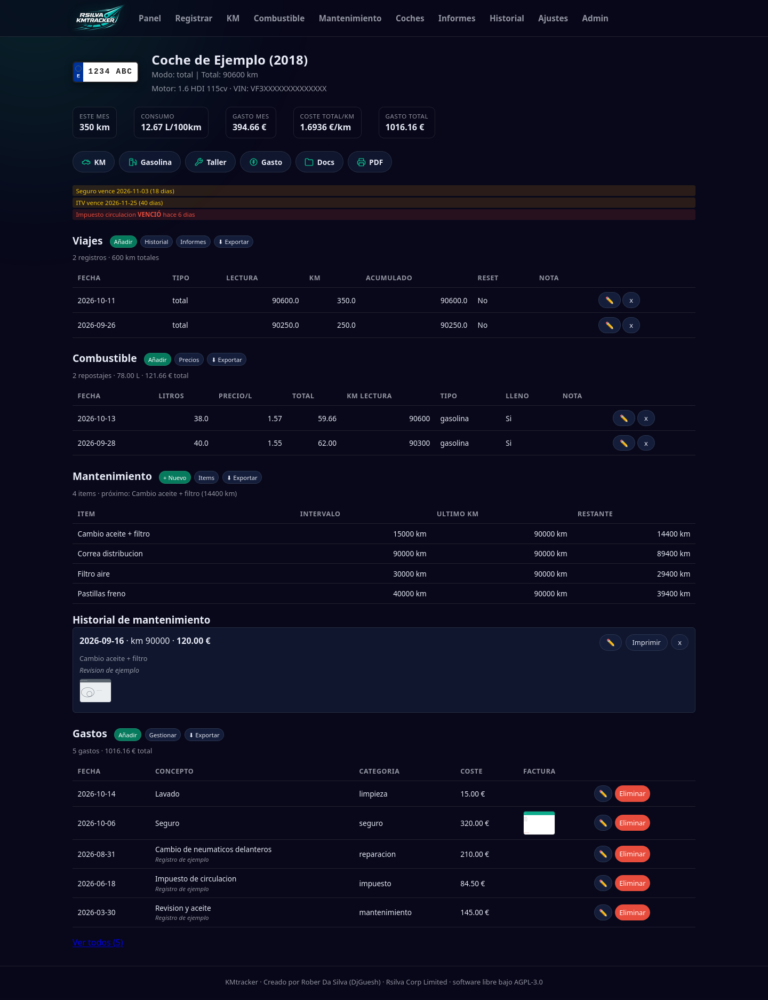

At the top you'll find its data, the summary indicators (this month, consumption,
monthly spend, cost/km, total spend) and the **renewal warnings**. The quick
action buttons (**KM**, **Gasolina**, **Taller**, **Gasto**, **Docs**, **PDF**)
take you straight to that vehicle's corresponding form.

Below are its sections, each with its own rows and **edit** (pencil) and **delete**
(cross) buttons:

- **Viajes / Mileage**
- **Fuel**
- **Maintenance** (with the tasks, their next due point and remaining km)
- **Maintenance history**
- **Expenses**

### Marking a vehicle as "test" or "sold"

From the detail page you can edit the vehicle to mark it as **test** or as
**sold/decommissioned**. An archived vehicle is **not deleted**: it keeps its whole
history, it just no longer appears as active.

---

## 5. Mileage

In **KM** you record the kilometres driven. First choose the vehicle:

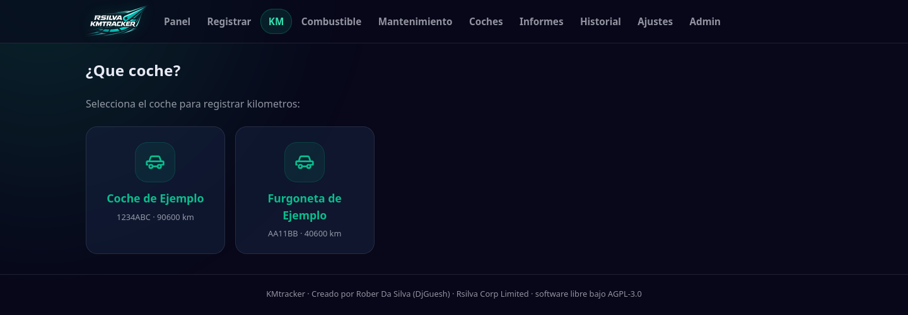

Then fill in the form:

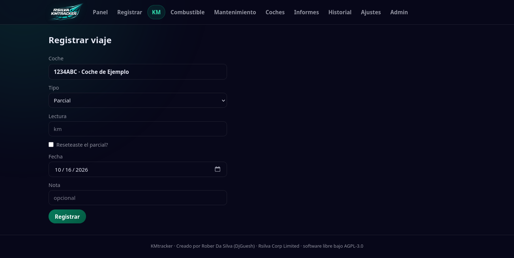

Depending on how the vehicle is configured:

- **Total odometer** — you enter the **odometer reading** (for example `90600`)
  and KMtracker computes the distance since the previous reading.
- **Trip meter** — you enter the **trip kilometres**.

The result is computed automatically; you don't do any maths.

### Fixing a mistake

If you typed something wrong, click the **pencil** on the row and correct the
value. KMtracker **recalculates in a chain** every affected distance and
consumption figure. The full mileage history of each vehicle is always available
on its detail page.

---

## 6. Fuel

In **Combustible** (Fuel) you record refuellings and the real consumption is
computed.

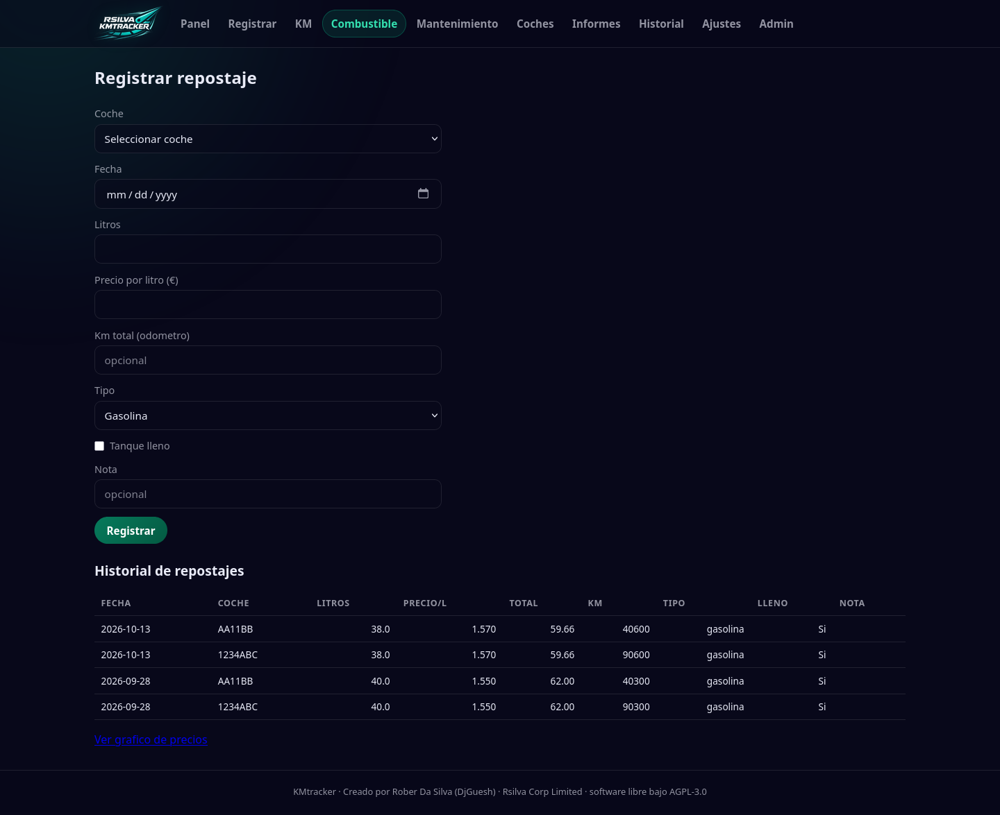

For each refuelling the app stores:

- **Litros** — litres refuelled.
- **Precio por litro** and **total** — price per litre and the amount.
- **Kilómetros** — the odometer reading at that moment.
- **Tipo** — petrol or diesel.
- **Depósito lleno** — tick this when you fill the tank completely.

> **Tip:** for the consumption calculation to be exact, tick **"full tank"** only
> when you have really filled it up. Between two full tanks, the difference in
> kilometres and the litres refuelled give the real consumption in **L/100 km**.

### Price history

The **Precios** link opens a fuel price history, useful to see how the price has
evolved over time.

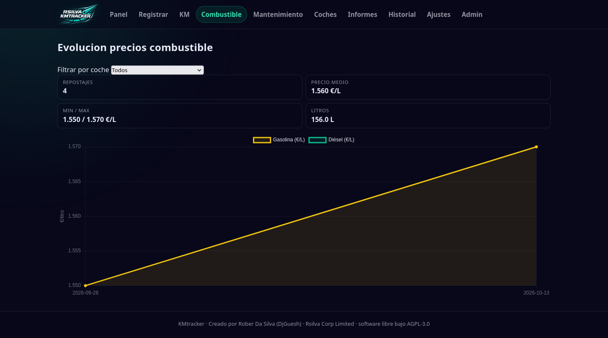

If needed, you can **edit** a refuelling to correct the odometer or any other
value.

---

## 7. Expenses

On the vehicle detail page, the **Gastos** (Expenses) section records everything
that is not fuel or maintenance.

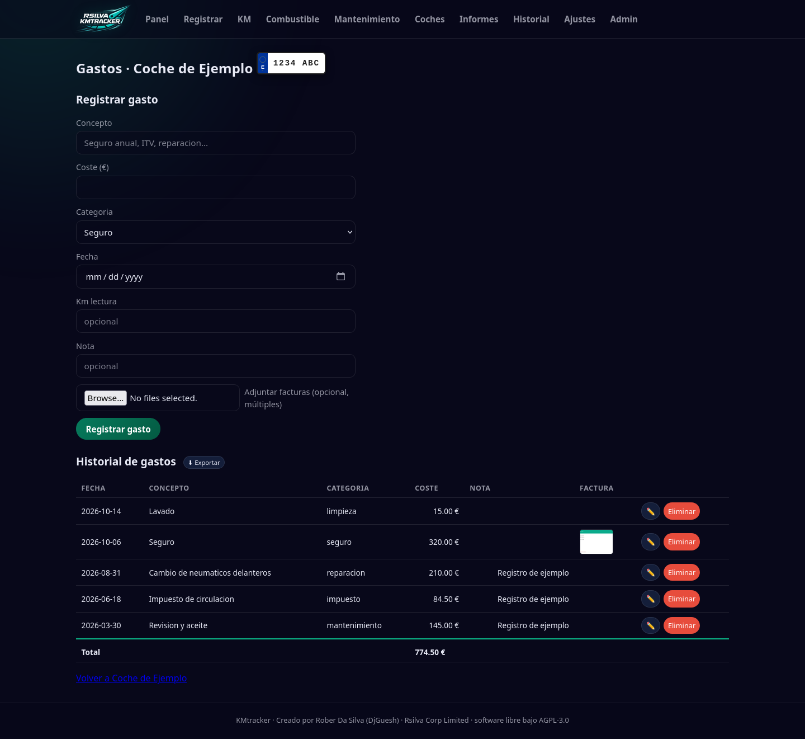

Each expense has:

- **Date**
- **Concept** — free description (for example, "Annual insurance").
- **Category** — one of:
  **seguro · ITV · impuesto · reparación · limpieza · mantenimiento · mejoras ·
  otro** (insurance · roadworthiness · tax · repair · cleaning · maintenance ·
  upgrades · other).
- **Cost**
- **Invoice** (optional) — a **photo** of the receipt or invoice.
- **Note** (optional)

Expenses are totalled per vehicle and per period, and are taken into account in
all the dashboard and report statistics.

---

## 8. Maintenance

KMtracker distinguishes between **tasks** (what has to be done every so many
kilometres) and **services performed** (what you have already done).

### Maintenance tasks

In **Mantenimiento** (Maintenance) you manage the list of control tasks and their
intervals in kilometres.

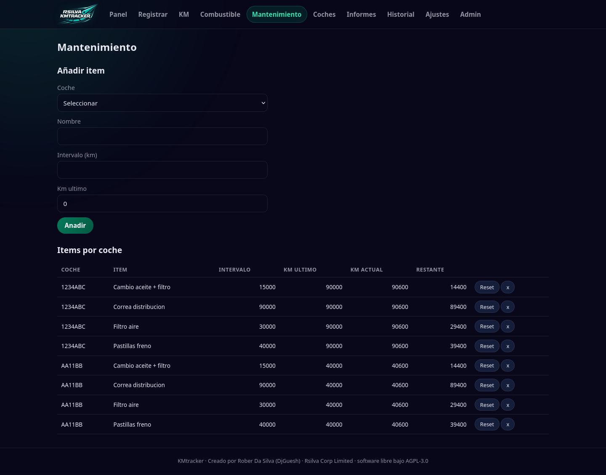

- Each task has an **interval** (for example, "oil every 15,000 km").
- The application shows how many kilometres are **remaining** for each task and
  warns you when it is **due soon** or **overdue**.

### Recording a service performed

To log a maintenance job done, open the vehicle and click **Nuevo** in the
maintenance section.

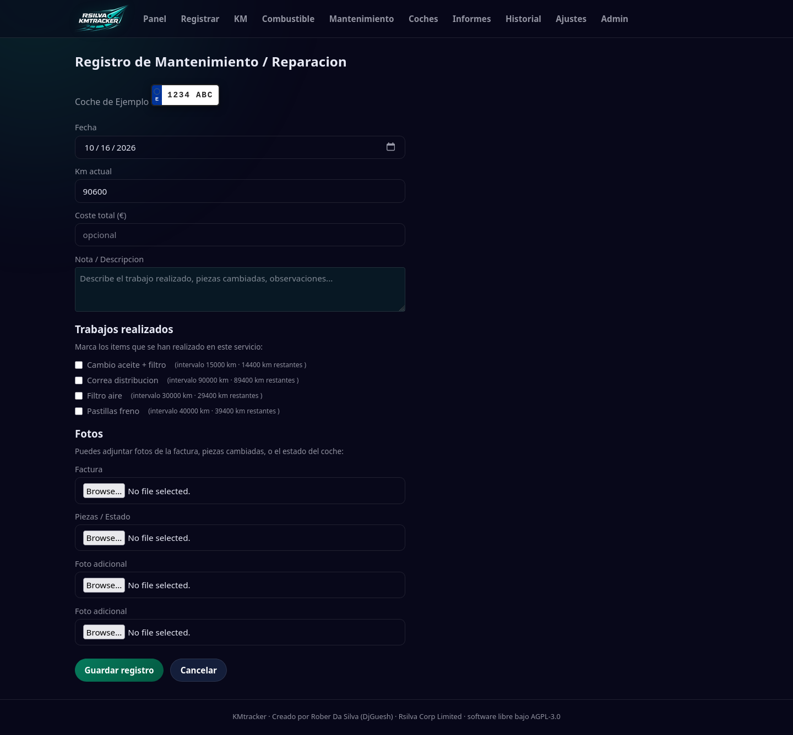

You record:

- The **date** and the **kilometres** at which it was done.
- The **cost** and a **note**.
- The **tasks** covered (ticking them from the list), so their countdown restarts.
- Optionally, **photos**.

### Thermal ticket (58 mm)

Each service performed can be printed as a **58 mm thermal ticket**, ideal for a
receipt printer. The ticket page also lets you save it as a **PNG**.

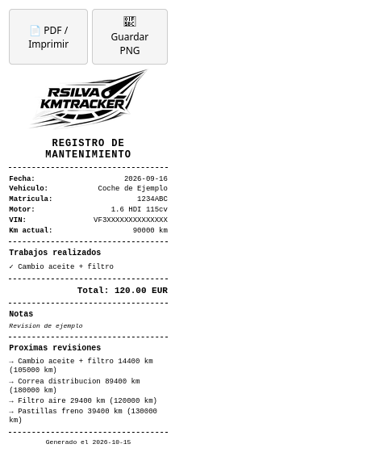

You can also generate a **PDF** with the maintenance summary of each vehicle from
its detail page (the **PDF** button).

---

## 9. Documents

In the **Docs** section of each vehicle's detail page you can store its
documentation: registration certificate, technical data sheet, insurance
policies, contracts, etc.

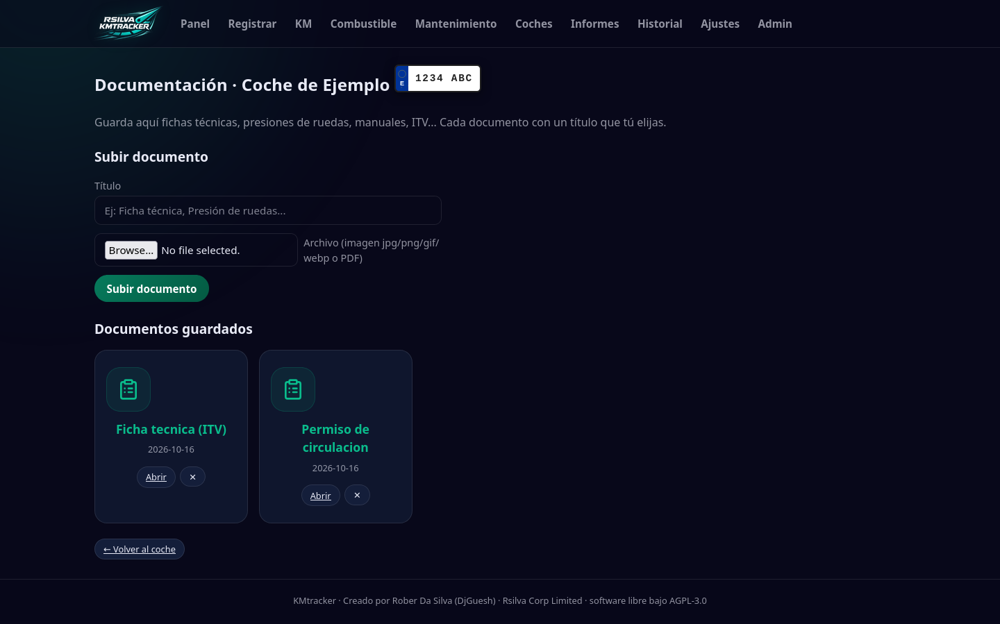

Documents are stored **inside the database**, so they always travel with your
backups. You can **download** them whenever you need.

---

## 10. Reports

In **Informes** (Reports) you get summaries by month range and by vehicle.

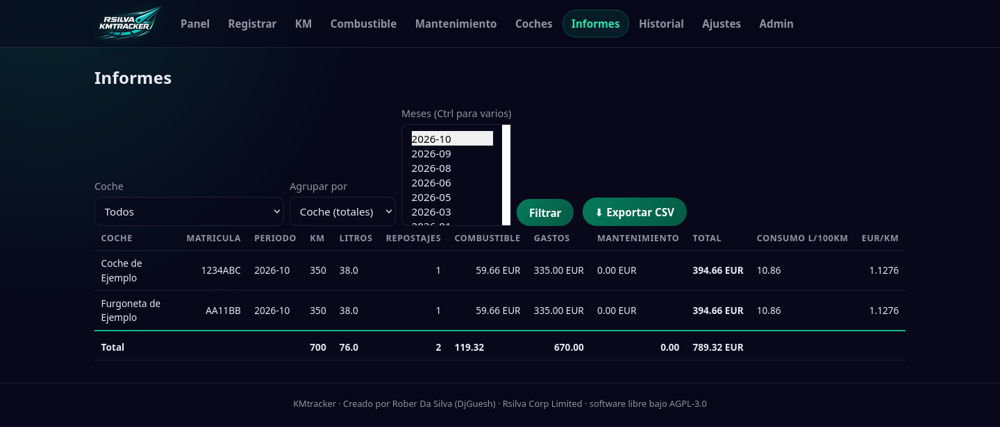

- Choose the **month range** and, optionally, a specific **vehicle** (or all).
- It shows the total kilometres, fuel, expenses and maintenance for the period.
- You can **export to CSV**, a format that opens directly in Excel or any
  spreadsheet.
- There is a **daily report** of movements and a **report ticket** ready to print.

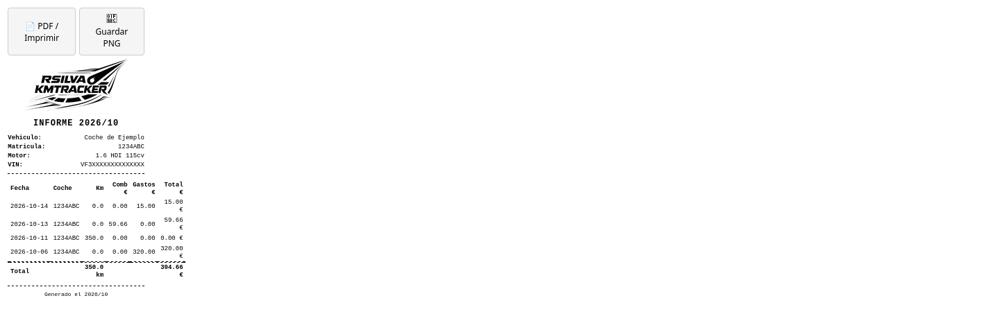

The CSV is also available from each vehicle's detail page, to export only its
data.

---

## 11. History

In **Historial** (History) you have the chronological record of activity.

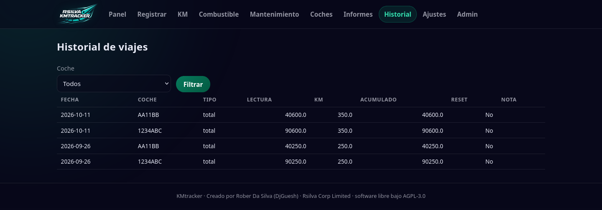

It is the most convenient view to review "what happened" for a vehicle or for the
whole fleet: mileage readings, refuellings and other movements, in order.

---

## 12. Settings

In **Ajustes** (Settings) you personalise the dashboard and the warnings.

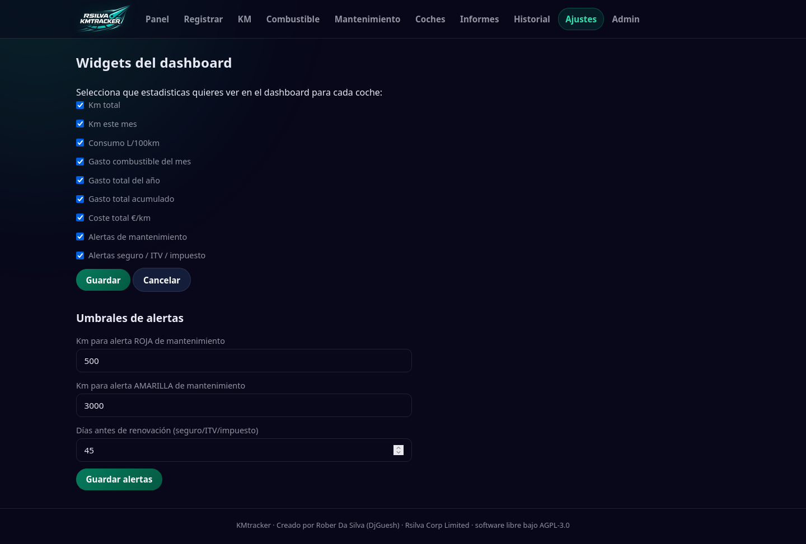

### Dashboard widgets

Tick or untick the statistics you want to see on the dashboard cards:

- Km total · Km this month · Consumption L/100 km · Monthly fuel spend · Total
  yearly spend · Total cost €/km · Accumulated total spend · Maintenance alerts ·
  Insurance / roadworthiness / tax alerts.

### Alert thresholds

- **Km for RED alert** of maintenance (default, 500 km): when a task has fewer
  than those kilometres left, it is shown in red.
- **Km for YELLOW alert** of maintenance (default, 3,000 km): advance warning.
- **Days before renewal** (default, 45): how far in advance you want to be warned
  about **insurance, roadworthiness test and tax**.

---

## 13. Administration

In **Admin** you configure the bot and manage backups.

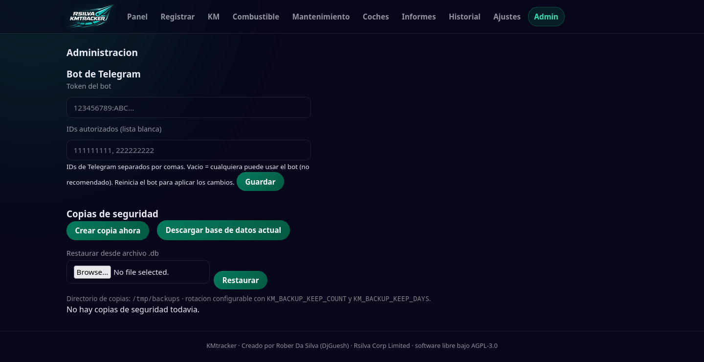

- **Telegram bot** — the bot token and the list of authorised IDs (see the next
  section).
- **Backups** — create a backup now, list existing ones, download, **restore** or
  delete them, and download/upload the database file directly.

> These functions are sensitive. Keep the access password safe.

---

## 14. The Telegram bot

The **Telegram bot** is optional and lets you log entries from your phone without
opening the browser.

### Setup

1. Talk to [@BotFather](https://t.me/BotFather) in Telegram, create a bot and copy
   the **token** it gives you.
2. Find your numeric **Telegram ID** (for example, with
   [@userinfobot](https://t.me/userinfobot)).
3. Enter the token and your ID in the **Admin** section of KMtracker (or in the
   `.env` file, see [Installation and configuration](#16-installation-and-configuration)).
4. Restart the bot to apply the changes.

> **Very important:** always configure the **allow-list** of authorised IDs.
> Without it, anyone who finds your bot could read and modify your data.

### Available commands

| Command | What it's for |
|---|---|
| `/start` | Welcome and command list. |
| `/menu` | Menu with buttons. |
| `/km` | Log a trip. |
| `/repostar` | Log a refuelling. |
| `/gasto` | Log an expense. |
| `/mantenimiento` | Manage maintenance tasks. |
| `/check` | Summary of a car. |
| `/alertas` | Alerts for all cars. |
| `/cancel` | Cancel the current operation. |

---

## 15. Backups

Your data lives in a single file (the SQLite database), so making backups is very
simple.

From **Admin** you can:

- **Create a backup now** (saved as `kmtracker_<date>.tar.gz`).
- **List**, **download**, **restore** and **delete** existing backups.
- **Download** or **upload** the `.db` database file directly.

Backups are created and **purged automatically** by age, with two settings:

- `KM_BACKUP_KEEP_COUNT` — how many backups are always kept (default 10).
- `KM_BACKUP_KEEP_DAYS` — backups older than this many days are deleted (default
  30).

> **Tip:** point the backup folder (`KM_BACKUP_DIR`) to a **mounted NAS** or a
> **cloud-synced folder**, and you'll have off-server copies for free.

---

## 16. Installation and configuration

KMtracker can run in two ways:

### With Docker (recommended)

Requirements: **Docker** and **Docker Compose**.

```bash
git clone https://github.com/Robertomola18/kmtracker.git
cd kmtracker
cp .env.example .env          # edit .env and set KMTRACKER_PASSWORD
docker compose up -d --build
```

Open `http://localhost:5050` and sign in with the password you set.

### Without Docker (Python)

```bash
python3 -m venv venv && . venv/bin/activate
pip install -r requirements.txt
KMTRACKER_DB_PATH=./kmtracker.db KMTRACKER_PASSWORD=your-password \
  python3 app.py
```

### Configuration variables (`.env`)

| Variable | Default | What it does |
|---|---|---|
| `KMTRACKER_PASSWORD` | — | Web access password. **Required** the first time. |
| `KMTRACKER_DB_PATH` | `/data/kmtracker.db` | Path of the SQLite database file. |
| `KMTRACKER_SECRET_KEY` | generated in `/data/.secret_key` | Flask session key. |
| `TZ` | `Europe/Madrid` | Time zone. |
| `KM_BACKUP_DIR` | DB folder + `/backups` | Folder where backups are stored. |
| `KM_BACKUP_KEEP_COUNT` | `10` | Number of backups always kept. |
| `KM_BACKUP_KEEP_DAYS` | `30` | Maximum age (days) of backups. |
| `TELEGRAM_TOKEN` | — | Telegram bot token (also in **Admin**). |
| `TELEGRAM_ALLOWED_USER_IDS` | — | Authorised Telegram IDs, comma-separated. |

### Sample data (optional)

Want to try the application with made-up data?

```bash
docker compose exec kmtracker python3 /app/seed.py
```

### Updating

```bash
git pull
docker compose up -d --build
```

Your data is preserved in the `kmtracker_data` volume.

> **Security advice:** do not expose KMtracker directly to the Internet. Put it
> behind a reverse proxy with **HTTPS** (Caddy, nginx, Traefik) or a **VPN** such
> as Tailscale or WireGuard, and publish the port **only on your local network**.

---

## 17. FAQ and troubleshooting

**Do I need Internet to use it?**
No. You only need it for the Telegram bot (optional). Everything else works on
your local network.

**Where is my data stored?**
In a single SQLite file inside the `kmtracker_data` volume. You can copy it and
take it with you whenever you want.

**Can I use it with several people?**
Access is via a shared password. It is designed for personal or family use, not
multi-user with accounts.

**What if I record the wrong mileage?**
You can edit any reading (pencil icon). KMtracker automatically recalculates the
affected distances and consumption figures.

**Does it run on a Raspberry Pi?**
Yes. It is designed for modest hardware: Flask + SQLite use very little.

**I forgot my password.**
Set `KMTRACKER_PASSWORD` again in the `.env` file (or environment variable) and
restart the application.

**The Telegram bot does not respond.**
Check that the token is correct, that the bot is running and that your Telegram ID
is on the allow-list. Restart the bot after changing the configuration.

**How do I report a bug or request a feature?**
Open a [GitHub issue](https://github.com/Robertomola18/kmtracker/issues). For
**security** issues, use a private
[Security Advisory](https://github.com/Robertomola18/kmtracker/security/advisories/new).

---

## Contact and licence

- **Questions and suggestions:** [GitHub Discussions](https://github.com/Robertomola18/kmtracker/discussions).
- **Bugs and features:** [issues](https://github.com/Robertomola18/kmtracker/issues).

This project is distributed under the **GNU AGPL-3.0** licence (see
[LICENSE](../../LICENSE)).

<p align="center">
  <br>
  Created by <b>Rober Da Silva (DjGuesh)</b> · Rsilva Corp Limited
</p>
